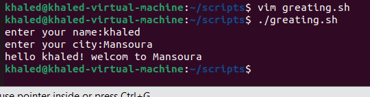
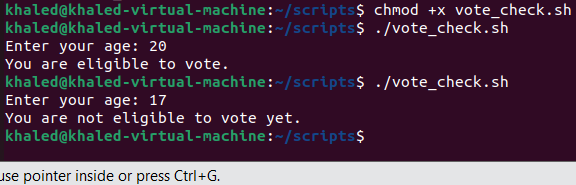
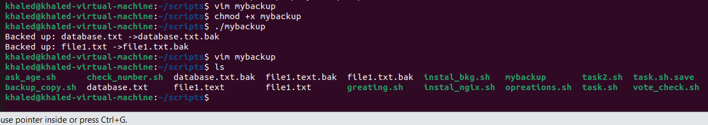
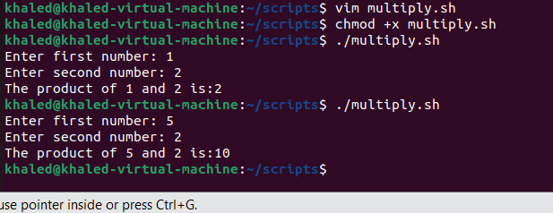
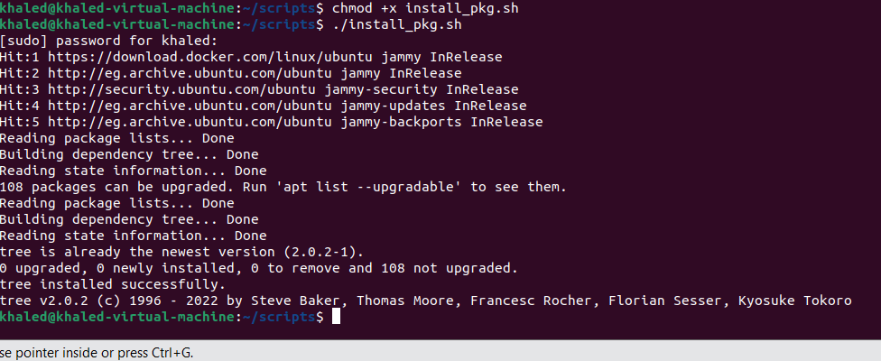
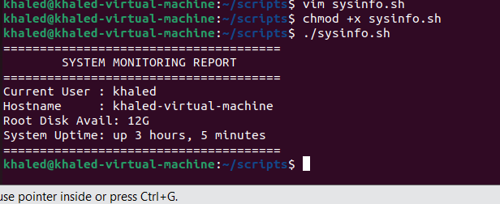

# Lab 03: Deep on Shell Scripting (Bash)

Practical Bash scripting exercises covering user input handling, conditional logic (`if/else`), `for` loops for automated file backups, arithmetic functions, package installation verification, and system monitoring.

---

## Problem 1: User Input & Formatting (`greeting.sh`)

Prompts the user for their name and city, then prints a formatted welcome message.

**1. Create the script file:**
```bash
vim greeting.sh
```

**2. Script content:**
```bash
#!/bin/bash
read -p "Enter your name: " name
read -p "Enter your city: " city

echo "Hello $name, welcome to$city!"
```

**3. Set permissions & run:**
```bash
chmod +x greeting.sh
./greeting.sh
```



---

## Problem 2: Conditional Statements (`vote_check.sh`)

Evaluates user age using `if/else` comparison operators to determine voting eligibility.

**1. Create the script file:**
```bash
vim vote_check.sh
```

**2. Script content:**
```bash
#!/bin/bash
read -p "Enter your age: " age

if [ "$age" -ge 18 ]; then
    echo "You are eligible to vote."
else
    echo "You are not eligible to vote yet."
fi
```

**3. Set permissions & run:**
```bash
chmod +x vote_check.sh
./vote_check.sh
```



---

## Problem 3: Loops & File Management (`mybackup`)

Iterates over all `.txt` files in the current working directory and creates `.bak` backup copies safely.

**1. Create the script file:**
```bash
vim mybackup
```

**2. Script content:**
```bash
#!/bin/bash
for file in *.txt; do
    if [ -f "$file" ]; then
        cp "$file" "${file}.bak"
        echo "Backed up: $file ->${file}.bak"
    fi
done
```

**3. Set permissions & run:**
```bash
chmod +x mybackup
./mybackup
```



---

## Problem 4: Functions & Arithmetic Operations (`multiply.sh`)

Passes two user-supplied integers as arguments to a Bash function that computes and prints their product.

**1. Create the script file:**
```bash
vim multiply.sh
```

**2. Script content:**
```bash
#!/bin/bash
multiply() {
    local result=$(( $1 * $2 ))
    echo "The product of $1 and $2 is:$result"
}

read -p "Enter first number: " num1
read -p "Enter second number: " num2

multiply "$num1" "$num2"
```

**3. Set permissions & run:**
```bash
chmod +x multiply.sh
./multiply.sh
```



---

## Problem 5: Package Management & Service Verification (`install_pkg.sh`)

Installs a target package (`tree`), checks the exit status (`$?`), and verifies the installed version.

**1. Create the script file:**
```bash
vim install_pkg.sh
```

**2. Script content:**
```bash
#!/bin/bash
PKG="tree"

sudo apt update -y && sudo apt install -y "$PKG"

if [ $? -eq 0 ]; then
    echo "$PKG installed successfully."
    $PKG --version
else
    echo "Failed to install $PKG."
    exit 1
fi
```

**3. Set permissions & run:**
```bash
chmod +x install_pkg.sh
./install_pkg.sh
```



---

## Problem 6: System Monitoring & Information Retrieval (`sysinfo.sh`)

Retrieves and displays current user identity, hostname, root filesystem available space, and system uptime.

**1. Create the script file:**
```bash
vim sysinfo.sh
```

**2. Script content:**
```bash
#!/bin/bash
echo "======================================"
echo "        SYSTEM MONITORING REPORT      "
echo "======================================"
echo "Current User : $(whoami)"
echo "Hostname     : $(hostname)"
echo "Root Disk Avail: $(df -h / | awk 'NR==2 {print $4}')"
echo "System Uptime: $(uptime -p)"
echo "======================================"
```

**3. Set permissions & run:**
```bash
chmod +x sysinfo.sh
./sysinfo.sh
```


